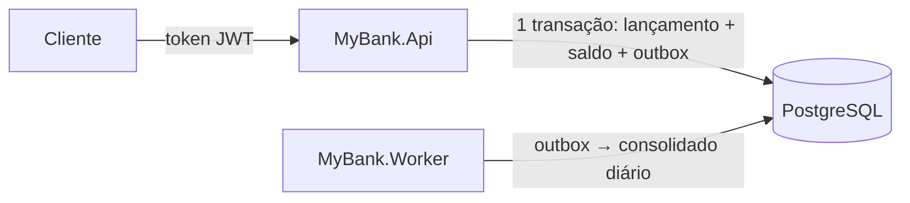

# MyBank: controle de lançamentos financeiros

Registra créditos e débitos em contas, consulta o saldo atual ou em qualquer instante passado e produz a consolidação diária (resumo de cada conta por dia) de forma assíncrona, ou seja, separada do registro.

**Garantias:** lançamento, novo saldo e evento da consolidação são gravados na mesma transação (pacote de gravações que entra inteiro ou não entra nada). Débitos simultâneos na mesma conta entram em fila, então o saldo nunca fica negativo. Repetir uma requisição com a mesma `Idempotency-Key` (número do pedido escolhido pelo cliente) é seguro e não duplica o lançamento. O saldo histórico vem do razão (registro imutável de todos os lançamentos). Se o worker (programa que faz a consolidação em segundo plano) cair, a consolidação continua de onde parou, sem perder nem duplicar. Tudo isso é testado contra um PostgreSQL real e sob carga de 50 requisições por segundo.

## Arquitetura em uma linha

Monólito modular (um único sistema e um único banco, dividido em partes bem separadas) em .NET 10: **API** (recebe os pedidos HTTP) + **worker** de consolidação (processo separado) + **PostgreSQL** (banco de dados), ligados por uma **Transactional Outbox** (tabela de "bilhetes pendentes" gravada junto com cada lançamento e lida depois pelo worker).



```text
src/MyBank.Core         Entidades, banco (EF Core + migrations), regras (LedgerService) e consolidação (DailyBalanceProjector)
src/MyBank.Api          Endpoints, autenticação JWT, erros em problem+json, health checks
src/MyBank.Worker       Processa a outbox em um laço contínuo
tests/MyBank.Tests      Um teste por critério de aceite, com API e PostgreSQL reais
tools/MyBank.LoadTests  Teste de carga a 50 req/s com verificação de perda e duplicação
```

Termos: **EF Core** (biblioteca que traduz classes C# em tabelas e consultas); **migrations** (scripts que criam e atualizam as tabelas); **endpoints** (endereços da API); **JWT** (crachá digital assinado que identifica o usuário); **problem+json** (formato padrão de resposta de erro); **health checks** (endereços que dizem se o sistema está saudável); **req/s** (requisições por segundo).

| Documento | Conteúdo |
|---|---|
| [docs/Arquitetura.md](docs/Arquitetura.md) | Decisões e alternativas, fluxos, garantias, segurança, operação e falhas, critérios de aceite e evidências, evoluções |
| [docs/Teste-de-Carga.md](docs/Teste-de-Carga.md) | Interpretação dos 5%, método, resultados e limitações |

## Pré-requisitos

- .NET SDK 10.x (kit de desenvolvimento do .NET)
- Docker (roda o PostgreSQL local e o banco temporário dos testes)

## Executando localmente

```powershell
# 1. PostgreSQL
docker compose up -d

# 2. API em http://localhost:5013 (em Development, cria ou atualiza as tabelas ao subir)
dotnet run --project src/MyBank.Api

# 3. Worker de consolidação (outro terminal)
dotnet run --project src/MyBank.Worker
```

A connection string (texto com endereço, usuário e senha do banco) fica em `appsettings.Development.json` (API e Worker). Ela usa as credenciais **apenas locais** do `docker-compose.yml` (`postgres` / `test123`, banco `mybank`). Para usar outro banco, defina a variável de ambiente `ConnectionStrings__MyBankDb`. Fora do ambiente local:

- informe a connection string por variável de ambiente ou secret store (cofre de senhas);
- configure um provedor OIDC (sistema de login padrão de mercado) em `Auth:Authority`;
- aplique as migrations no deploy (implantação): `dotnet ef database update --project src/MyBank.Core`.

## Usando a API

As rotas de negócio exigem o header (cabeçalho HTTP) `Authorization: Bearer <token>`. Em Development (ambiente de desenvolvimento), `POST /dev/token` emite tokens locais. O titular da conta é a claim (campo do token) `sub`, e abrir conta exige o papel `accounts-admin`.

O arquivo [MyBank.Api.http](src/MyBank.Api/MyBank.Api.http) tem o fluxo completo para executar no VS Code (extensão REST Client) ou no Visual Studio. Com `curl` (cliente HTTP de linha de comando):

```bash
API=http://localhost:5013

ADMIN=$(curl -s -X POST $API/dev/token -H 'Content-Type: application/json' -d '{"subject":"admin","roles":["accounts-admin"]}' | jq -r .accessToken)
ALICE=$(curl -s -X POST $API/dev/token -H 'Content-Type: application/json' -d '{"subject":"alice"}' | jq -r .accessToken)

# Abrir conta da alice com saldo inicial
ACC=$(curl -s -X POST $API/api/v1/accounts -H "Authorization: Bearer $ADMIN" -H 'Content-Type: application/json' \
  -d '{"ownerId":"alice","initialBalance":100.00}' | jq -r .id)

# Crédito. Repetir o comando devolve o mesmo lançamento com "Idempotent-Replayed: true".
curl -i -X POST $API/api/v1/accounts/$ACC/entries -H "Authorization: Bearer $ALICE" \
  -H 'Idempotency-Key: pedido-001' -H 'Content-Type: application/json' \
  -d '{"type":"credit","amount":50.25,"currency":"BRL","description":"depósito"}'

# Saldo atual, saldo em um instante e consolidação diária
curl -s $API/api/v1/accounts/$ACC/balance -H "Authorization: Bearer $ALICE"
curl -s "$API/api/v1/accounts/$ACC/balance?at=2026-10-09T12:00:00Z" -H "Authorization: Bearer $ALICE"
curl -s "$API/api/v1/accounts/$ACC/daily-balances?from=2026-10-01&to=2026-10-31" -H "Authorization: Bearer $ALICE"
```

| Endpoint | Descrição |
|---|---|
| `POST /api/v1/accounts/{id}/entries` | Crédito/débito; `Idempotency-Key` obrigatório |
| `GET /api/v1/accounts/{id}/entries/{entryId}` | Lançamento |
| `GET /api/v1/accounts/{id}/balance[?at=ISO-8601 com fuso]` | Saldo atual ou histórico (ISO-8601 é o formato padrão de data e hora, ex.: `2026-10-09T12:00:00Z`) |
| `GET /api/v1/accounts/{id}/daily-balances?from=&to=` | Consolidação diária (datas em UTC, o horário universal) e atraso da projeção |
| `POST /api/v1/accounts` | Abertura de conta (papel `accounts-admin`) |
| `POST /dev/token` | Token local (somente Development) |
| `GET /health/live`, `/health/ready`, `/health/projection` | Processo no ar, banco disponível e atraso da consolidação |
| `GET /openapi/v1.json` | Contrato OpenAPI (descrição padrão dos endereços da API; somente Development) |

Os erros seguem `application/problem+json` com um `code` estável (ex.: `insufficient_funds` = saldo insuficiente, `idempotency_key_reused` = número de pedido reusado com outro conteúdo, `invalid_scale` = mais de 2 casas decimais). O contrato completo está na [seção 5 de Arquitetura.md](docs/Arquitetura.md#5-api).

## Testes

```powershell
dotnet build MyBank.slnx -c Release
dotnet test MyBank.slnx -c Release
```

O build trata warnings (avisos do compilador) como erro. Os testes sobem um PostgreSQL descartável via Testcontainers (biblioteca que cria o banco no Docker só durante o teste), então o **Docker precisa estar em execução**. O CI (integração contínua: o GitHub compila e testa a cada envio), definido em [ci.yml](.github/workflows/ci.yml), roda build e testes.

| Classe | Cobre |
|---|---|
| `AcceptanceCriteriaTests` | Critérios de aceite 1 a 9 da demanda, um teste cada (`C01`…`C09`): crédito, débito, validações, saldo insuficiente, 50 débitos simultâneos, idempotência (inclusive simultânea), conflito de chave, worker parado, saldo histórico |
| `ProjectionTests` | 4 workers simultâneos sem duplicar, reconstrução do consolidado, health da projeção, validação do período |
| `SecurityTests` | 401 (sem token), 403 (conta de outro titular), papel admin, validação da abertura de conta, campos proibidos no corpo, instante sem fuso, razão imutável no banco |

## Teste de carga

Com API e worker rodando (de preferência em Release, a compilação otimizada):

```powershell
dotnet run --project src/MyBank.Api -c Release
dotnet run --project src/MyBank.Worker -c Release
dotnet run --project tools/MyBank.LoadTests -c Release -- --scenario mixed --rate 50 --duration 60
```

Cenários: `mixed` (misto), `hot-account` (todos os lançamentos na mesma conta) e `daily-balance` (só consultas ao consolidado). No final, a ferramenta confere saldos, razão (zero perdido, zero duplicado) e se a consolidação ficou em dia. Resultados em [docs/Teste-de-Carga.md](docs/Teste-de-Carga.md).
