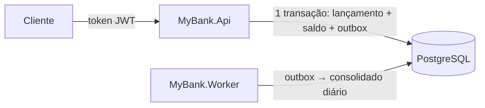

# MyBank: controle de lançamentos financeiros

Registra créditos e débitos em contas, consulta o saldo atual ou em qualquer instante passado e produz a consolidação diária (resumo de cada conta por dia) de forma assíncrona, ou seja, separada do registro.

**Garantias:** lançamento, novo saldo e evento da consolidação são gravados na mesma transação (pacote de gravações que entra inteiro ou não entra nada). Débitos simultâneos na mesma conta entram em fila, então o saldo nunca fica negativo. Repetir uma requisição com a mesma `Idempotency-Key` (número do pedido escolhido pelo cliente) é seguro e não duplica o lançamento. O saldo histórico vem do razão (registro imutável de todos os lançamentos). Se o worker (programa que faz a consolidação em segundo plano) cair, a consolidação continua de onde parou, sem perder nem duplicar. Tudo isso é testado contra um PostgreSQL real e sob carga de 50 requisições por segundo.

## Arquitetura em uma linha

Monólito modular (um único sistema e um único banco, dividido em partes bem separadas) em .NET 10: **API** (recebe os pedidos HTTP) + **worker** de consolidação (processo separado) + **PostgreSQL** (banco de dados), ligados por uma **Transactional Outbox** (tabela de "bilhetes pendentes" gravada junto com cada lançamento e lida depois pelo worker).



*Diagrama de Arquitetura (visão geral)*

```text
src/MyBank.Domain       Entidades e regras de negócio puras, sem dependência de banco ou framework
src/MyBank.Core         Casos de uso, consolidação e acesso ao banco (EF Core + migrations)
src/MyBank.Api          API HTTP: endpoints, contratos, autenticação e tratamento de erros
src/MyBank.Worker       Processa a outbox e mantém a consolidação diária
tests/MyBank.Tests      Testes unitários (regras) e de integração (API e PostgreSQL reais)
tools/MyBank.LoadTests  Teste de carga a 50 req/s com verificação de perda e duplicação
```

Termos: **EF Core** (biblioteca que traduz classes C# em tabelas e consultas); **migrations** (scripts que criam e atualizam as tabelas); **endpoints** (endereços da API); **req/s** (requisições por segundo). A estrutura interna de cada projeto está na [seção 3.1 de Architecture.md](docs/Architecture.md#31-projetos-e-dependências).

**Por que não há camada de repositório:** o domínio fica isolado em `MyBank.Domain`, um projeto sem nenhuma referência, então o compilador impede que uma regra dependa de banco ou de HTTP. Já interfaces de repositório e unit of work (unidade de trabalho) só repassariam chamadas ao `DbContext` do EF Core, que já implementa esses dois padrões, e esconderiam as garantias específicas do PostgreSQL. Detalhes e quando reavaliar no [ADR-0008](docs/adr/0008-dominio-isolado-sem-repositorio.md).

## Documentação

| Documento | Conteúdo |
|---|---|
| [docs/Architecture.md](docs/Architecture.md) | Documento principal: decisões, fluxos, garantias, segurança, falhas, alternativas, requisitos não funcionais, evidências e evoluções |
| [docs/C4.md](docs/C4.md) | Diagramas da arquitetura no modelo C4: contexto, contêineres e componentes |
| [docs/ADR.md](docs/ADR.md) | Registros de decisão de arquitetura (ADRs): uma decisão por arquivo, com contexto, alternativas e consequências |
| [docs/Load-Tests.md](docs/Load-Tests.md) | Interpretação dos 5%, método, resultados e limitações do teste de carga |

### Onde está cada ponto da avaliação

| Ponto | Onde |
|---|---|
| Arquitetura, separação de responsabilidades e alternativas (monólito modular × microsserviços) | [Architecture §1](docs/Architecture.md#1-resumo) (decisões, tecnologias, padrões e SOLID), [§8](docs/Architecture.md#8-alternativas-consideradas) (alternativas), [C4.md](docs/C4.md), ADRs [0001](docs/adr/0001-monolito-modular.md) e [0008](docs/adr/0008-dominio-isolado-sem-repositorio.md) |
| Resiliência: lançamentos disponíveis sem a consolidação, outbox, retry, reprocessamento, idempotência | [Architecture §4](docs/Architecture.md#4-fluxos-e-garantias) (fluxos) e [§7](docs/Architecture.md#7-operação-e-falhas) (falhas), ADRs [0003](docs/adr/0003-outbox-transacional-sem-broker.md), [0005](docs/adr/0005-idempotencia-no-lancamento.md) e [0006](docs/adr/0006-consolidacao-independente-de-ordem.md) |
| Performance: 50 req/s com no máximo 5% de perda, cache, índices, escala horizontal | [Load-Tests.md](docs/Load-Tests.md) (inclusive com o worker parado), [Architecture §7](docs/Architecture.md#7-operação-e-falhas) (escala) e [§8](docs/Architecture.md#8-alternativas-consideradas) (por que sem cache) |
| Segurança: autenticação, autorização por conta, validação, dados sensíveis | [Architecture §6](docs/Architecture.md#6-segurança), [ADR-0009](docs/adr/0009-autenticacao-jwt-autorizacao-por-titular.md) |
| Testes: regras, falhas, reprocessamento, idempotência, integração e carga | [Testes](#testes) (abaixo), [Architecture §10](docs/Architecture.md#10-critérios-de-aceite-e-evidências) (cada critério de aceite e sua evidência) |
| Requisitos não funcionais, trade-offs e evoluções futuras | [Architecture §9](docs/Architecture.md#9-requisitos-não-funcionais), [§8](docs/Architecture.md#8-alternativas-consideradas) e [§11](docs/Architecture.md#11-evoluções-futuras) |

## Pré-requisitos

- .NET SDK 10.x (kit de desenvolvimento do .NET)
- Docker (roda o PostgreSQL local e o banco temporário dos testes)
- Opcional, só para o exemplo com `curl`: um terminal bash (Git Bash ou WSL no Windows) e o `jq` (programa que lê JSON no terminal)

## Executando localmente

```powershell
# 1. PostgreSQL
docker compose up -d

# 2. API em http://localhost:5013 (em Development, cria ou atualiza as tabelas ao subir)
dotnet run --project src/MyBank.Api

# 3. Worker de consolidação (outro terminal)
dotnet run --project src/MyBank.Worker
```

A connection string (texto com endereço, usuário e senha do banco) fica em `appsettings.Development.json` (API e Worker). Ela usa as credenciais **apenas locais** do `docker-compose.yml` (`postgres` / `test123`, banco `mybank`). Para usar outro banco, defina a variável de ambiente `ConnectionStrings__MyBankDb`. Fora do ambiente local:

- informe a connection string por variável de ambiente ou secret store (cofre de senhas);
- configure um provedor OIDC (sistema de login padrão de mercado) em `Auth:Authority`;
- aplique as migrations no deploy (implantação): `dotnet ef database update --project src/MyBank.Core`.

## Usando a API

As rotas de negócio exigem o header (cabeçalho HTTP) `Authorization: Bearer <token>`, com um token JWT (crachá digital assinado que identifica o usuário). Em Development (ambiente de desenvolvimento), `POST /dev/token` emite tokens locais. O titular da conta é a claim (campo do token) `sub`, e abrir conta exige o papel `accounts-admin`.

O jeito mais simples de testar é o arquivo [MyBank.Api.http](src/MyBank.Api/MyBank.Api.http): ele tem o fluxo completo (tokens, abertura de conta, lançamentos e consultas) para executar no VS Code (extensão REST Client) ou no Visual Studio, sem instalar mais nada.

Alternativa com `curl` (cliente HTTP de linha de comando), em um terminal bash. No PowerShell do Windows, `curl` é outro comando e o exemplo não funciona como está:

```bash
API=http://localhost:5013

ADMIN=$(curl -s -X POST $API/dev/token -H 'Content-Type: application/json' -d '{"subject":"admin","roles":["accounts-admin"]}' | jq -r .accessToken)
ALICE=$(curl -s -X POST $API/dev/token -H 'Content-Type: application/json' -d '{"subject":"alice"}' | jq -r .accessToken)

# Abrir conta da alice com saldo inicial
ACC=$(curl -s -X POST $API/api/v1/accounts -H "Authorization: Bearer $ADMIN" -H 'Content-Type: application/json' \
  -d '{"ownerId":"alice","initialBalance":100.00}' | jq -r .id)

# Crédito. Repetir o comando devolve o mesmo lançamento com "Idempotent-Replayed: true".
curl -i -X POST $API/api/v1/accounts/$ACC/entries -H "Authorization: Bearer $ALICE" \
  -H 'Idempotency-Key: pedido-001' -H 'Content-Type: application/json' \
  -d '{"type":"credit","amount":50.25,"currency":"BRL","description":"pagamento recebido"}'

# Saldo atual, saldo em um instante e consolidação diária
curl -s $API/api/v1/accounts/$ACC/balance -H "Authorization: Bearer $ALICE"
curl -s "$API/api/v1/accounts/$ACC/balance?at=2026-10-09T12:00:00Z" -H "Authorization: Bearer $ALICE"
curl -s "$API/api/v1/accounts/$ACC/daily-balances?from=2026-10-01&to=2026-10-31" -H "Authorization: Bearer $ALICE"
```

| Endpoint | Descrição |
|---|---|
| `POST /api/v1/accounts/{id}/entries` | Crédito/débito; `Idempotency-Key` obrigatório |
| `GET /api/v1/accounts/{id}/entries/{entryId}` | Lançamento |
| `GET /api/v1/accounts/{id}/balance[?at=ISO-8601 com fuso]` | Saldo atual ou histórico (ISO-8601 é o formato padrão de data e hora, ex.: `2026-10-09T12:00:00Z`) |
| `GET /api/v1/accounts/{id}/daily-balances?from=&to=` | Consolidação diária (datas em UTC, o horário universal) e atraso da projeção |
| `POST /api/v1/accounts` | Abertura de conta (papel `accounts-admin`) |
| `POST /dev/token` | Token local (somente Development) |
| `GET /health/live`, `/health/ready`, `/health/projection` | Processo no ar, banco disponível e atraso da consolidação |
| `GET /openapi/v1.json` | Contrato OpenAPI (descrição padrão dos endereços da API; somente Development) |

Os erros seguem `application/problem+json` (formato padrão de resposta de erro) com um `code` estável (ex.: `insufficient_funds` = saldo insuficiente, `idempotency_key_reused` = número de pedido reusado com outro conteúdo, `invalid_scale` = mais de 2 casas decimais). O contrato completo está na [seção 5 de Architecture.md](docs/Architecture.md#5-api).

## Testes

```powershell
dotnet test MyBank.slnx
```

O `dotnet test` compila a solução antes de rodar os testes, e a compilação trata warnings (avisos do compilador) como erro. O CI (integração contínua: o GitHub compila e testa a cada envio), definido em [ci.yml](.github/workflows/ci.yml), roda o mesmo em Release (compilação otimizada, como iria para produção).

O projeto de testes tem uma subpasta por tipo de teste:

- **`Unit/`** (testes unitários): testam as regras de negócio de `LedgerRules` (em `MyBank.Domain`) isoladas, sem banco e sem Docker. Rodam em menos de um segundo.
- **`Integration/`** (testes de integração): sobem a API inteira sobre um PostgreSQL descartável via Testcontainers (biblioteca que cria o banco no Docker só durante o teste), então o **Docker precisa estar em execução**. Provam o que só o banco garante: travas, transações, índices únicos e imutabilidade do razão.

Para rodar um tipo só, filtre pelo namespace (o nome da subpasta):

```powershell
dotnet test MyBank.slnx --filter "FullyQualifiedName~MyBank.Tests.Unit"
dotnet test MyBank.slnx --filter "FullyQualifiedName~MyBank.Tests.Integration"
```

| Classe | Tipo | Cobre |
|---|---|---|
| `InputValidationTests` | Unit | Valor, escala, moeda, tipo, chave de idempotência, descrição, titular, saldo inicial e período da consolidação |
| `BalanceRulesTests` | Unit | Crédito e débito exatos, saldo insuficiente, repetição com a mesma chave (mesmo conteúdo ou conflito), titularidade da conta |
| `DailySummaryTests` | Unit | Cálculo do dia consolidado (abertura, totais, fechamento), independente da ordem dos lançamentos |
| `AcceptanceCriteriaTests` | Integration | Critérios de aceite 1 a 9 da demanda, um teste cada (`C01`…`C09`): crédito, débito, validações, saldo insuficiente, 50 débitos simultâneos, idempotência (inclusive simultânea), conflito de chave, worker parado, saldo histórico |
| `ProjectionTests` | Integration | 4 workers simultâneos sem duplicar, reconstrução do consolidado, health da projeção, validação do período |
| `SecurityTests` | Integration | 401 (sem token), 403 (conta de outro titular), papel admin, validação da abertura de conta, campos proibidos no corpo, instante sem fuso, razão imutável no banco |

## Teste de carga

Com API e worker rodando em Release (compilação otimizada; o teste de carga mede tempo de resposta, então a configuração faz diferença aqui):

```powershell
dotnet run --project src/MyBank.Api -c Release
dotnet run --project src/MyBank.Worker -c Release
dotnet run --project tools/MyBank.LoadTests -c Release -- --scenario mixed --rate 50 --duration 60
```

Cenários: `mixed` (misto), `hot-account` (todos os lançamentos na mesma conta) e `daily-balance` (só consultas ao consolidado). No final, a ferramenta confere saldos, razão (zero perdido, zero duplicado) e se a consolidação ficou em dia. Resultados em [docs/Load-Tests.md](docs/Load-Tests.md).
