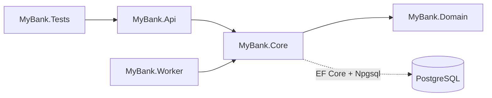
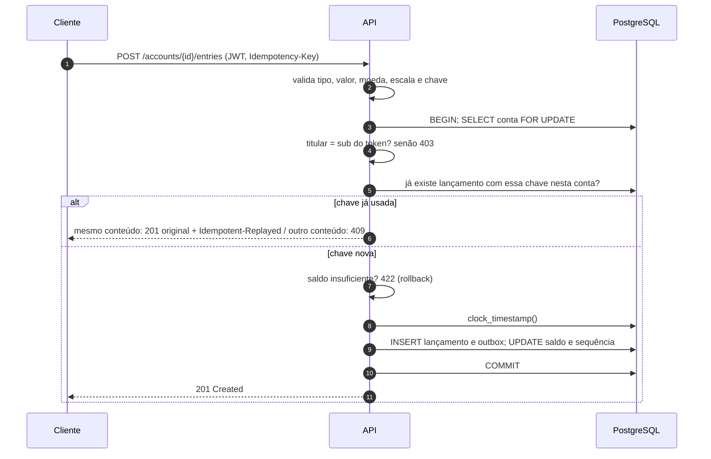
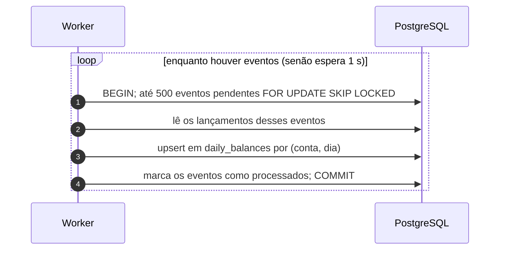

# Arquitetura — MyBank

Decisões, garantias e trade-offs (escolhas com ganhos e custos) da solução. Execução e uso estão no [README](../README.md); desempenho, em [Load-Tests.md](./Load-Tests.md). Termos técnicos são explicados entre parênteses no primeiro uso.

## 1. Resumo

Um **monólito modular** (um único sistema e um único banco, dividido em partes bem separadas) em .NET 10. São três peças: uma **API** (programa que recebe pedidos HTTP), um **worker** (programa separado que roda em segundo plano) e o **PostgreSQL** (banco de dados), que é a fonte de verdade. O lançamento é gravado de forma síncrona e atômica (a resposta só sai depois de tudo gravado, e grava-se tudo ou nada). A consolidação diária (resumo de cada conta por dia) é feita de forma assíncrona, depois, pelo worker, a partir de uma **Transactional Outbox** (tabela de "bilhetes pendentes" gravada na mesma transação do lançamento).

Cada decisão abaixo tem um ADR (registro de decisão de arquitetura) com contexto, alternativas e consequências, listados em [ADR.md](./ADR.md).

| Decisão | Escolha | Por quê | ADR |
|---|---|---|---|
| Estilo | Monólito modular: API + worker em processos separados, um banco | Atende à carga medida com a menor quantidade de peças. O worker separado isola a falha da consolidação | [0001](./adr/0001-monolito-modular.md) |
| Banco e garantias | PostgreSQL como fonte de verdade; transação, trava, índices únicos, check constraints e trigger no banco | As garantias valem para qualquer código e são testáveis contra o banco real | [0002](./adr/0002-postgresql-e-garantias-no-banco.md) |
| Consistência do saldo | Lançamento, novo saldo e evento gravados na **mesma transação** (pacote de gravações que entra inteiro ou não entra nada) | Sucesso só é respondido depois do commit (confirmação da transação). Não existe "meio lançamento" | [0003](./adr/0003-outbox-transacional-sem-broker.md) |
| Concorrência (pedidos simultâneos na mesma conta) | `SELECT ... FOR UPDATE` na linha da conta: um **lock** (trava) que reserva a linha até o fim da transação | Débitos da mesma conta entram em fila. Contas diferentes não disputam entre si | [0004](./adr/0004-trava-pessimista-por-conta.md) |
| Idempotência (repetir o pedido não muda o resultado) | Header (cabeçalho HTTP) `Idempotency-Key` obrigatório, com valor único por conta, garantido por índice único no banco | Retry (nova tentativa) após timeout (tempo esgotado) não duplica lançamento | [0005](./adr/0005-idempotencia-no-lancamento.md) |
| Consolidação | Outbox + worker, sem broker (programa intermediário de mensagens, como RabbitMQ ou Kafka); cálculo independente da ordem dos eventos | Worker parado não impede lançamentos. Um broker seria mais uma peça para operar sem ganho na carga atual | [0003](./adr/0003-outbox-transacional-sem-broker.md), [0006](./adr/0006-consolidacao-independente-de-ordem.md) |
| Saldo histórico | `balance_after` (saldo depois) do último lançamento até o instante pedido | Exato, uma linha lida por índice, independente da consolidação | [0007](./adr/0007-saldo-historico-pelo-razao.md) |
| Código | 4 projetos: `Domain` (entidades e regras puras), `Core` (casos de uso + acesso ao banco), `Api`, `Worker` | Domínio isolado da infraestrutura pelo compilador. Sem interfaces de repositório: o `DbContext` já é repositório e unit of work ([seção 8](#camadas-e-repositório)) | [0008](./adr/0008-dominio-isolado-sem-repositorio.md) |
| Segurança | JWT/OIDC; autorização pelo titular da conta (claim `sub`) | Padrão de mercado; cada cliente só acessa as próprias contas | [0009](./adr/0009-autenticacao-jwt-autorizacao-por-titular.md) |

**Princípio de projeto:** colocar as garantias no banco (transação, trava de linha, índices únicos, check constraints, que são regras de verificação, e trigger, um gatilho que o banco executa sozinho), não em camadas de código. São poucas e simples, e todas são verificáveis por testes contra um PostgreSQL real.

### Tecnologias e por quê

| Tecnologia | Por quê |
|---|---|
| C# / .NET 10 | Exigência da demanda. Versão LTS (suporte longo da Microsoft) |
| ASP.NET Core Minimal APIs (rotas mapeadas direto para métodos, sem a classe `Controller`) | Cinco endpoints não justificam a estrutura de controllers. Autenticação, validação de corpo e problem+json vêm do próprio framework |
| PostgreSQL | Tem nativamente o que garante a consistência: trava de linha (`FOR UPDATE`), fila concorrente (`SKIP LOCKED`), upsert (`ON CONFLICT`), decimal exato (`numeric`), check constraints e triggers. Código aberto |
| EF Core + Npgsql (biblioteca de acesso a banco e o driver do PostgreSQL) | Migrations versionadas e consultas tipadas. SQL explícito só onde a garantia depende dele (trava, upsert, relógio do banco) |
| JWT Bearer / OIDC | Padrão de mercado. Em produção, o login fica com um provedor de identidade; a API só valida o token |
| xUnit + Testcontainers | Testes de integração contra um PostgreSQL real e descartável: trava e transação são testadas de verdade, não simuladas |
| Gerador de carga próprio, em C# | Roda só com o SDK do .NET e confere no banco, ao final, que nenhum lançamento confirmado foi perdido ou duplicado, algo que ferramentas genéricas de carga não fazem |

### Padrões utilizados

| Padrão | Onde | Problema que resolve |
|---|---|---|
| Transactional Outbox | `LedgerService.RegisterEntryAsync` grava o evento; `DailyBalanceProjector` consome | Consolidação desacoplada sem perder nem duplicar eventos |
| Idempotency Key | Header `Idempotency-Key`, guardado no próprio lançamento | Retry do cliente sem lançamento duplicado |
| Trava pessimista (pessimistic lock: reservar a linha antes de alterar) | `SELECT ... FOR UPDATE` na conta | Débitos concorrentes sem saldo negativo |
| Competing Consumers (vários consumidores dividindo a mesma fila) | `FOR UPDATE SKIP LOCKED` na outbox | Vários workers sem processar o mesmo evento |
| Projeção de leitura (o lado de leitura do CQRS: uma visão derivada, separada da escrita) | `daily_balances`, mantida pelo worker | Consulta do consolidado sem recalcular o razão |
| Repository + Unit of Work | `MyBankDbContext` (o próprio EF Core) | Acesso a dados e transação ([Camadas e repositório](#camadas-e-repositório)) |

SOLID aplicado onde tem efeito prático: **responsabilidade única** (regras em `LedgerRules`, orquestração em `LedgerService`, HTTP nos endpoints, consolidação no `DailyBalanceProjector`) e **inversão de dependência** no nível dos projetos (o `Domain` não depende de nada; quem depende dele são as camadas externas).

## 2. Premissas

Premissas da demanda, adotadas como estão e cobertas por testes. Precisam de confirmação do negócio antes de ir para produção:

- Somente BRL, duas casas decimais; limite de R$ 1 trilhão por lançamento.
- A conta existe antes dos lançamentos e tem saldo inicial conhecido (abertura é uma operação administrativa).
- Saldo negativo não é permitido: débito acima do saldo dá `422 insufficient_funds` (saldo insuficiente).
- O instante do lançamento é dado pelo relógio do banco (`clock_timestamp()`, em UTC, o horário universal sem fuso), nunca pelo cliente.
- Lançamentos são imutáveis; correção é um novo lançamento compensatório.
- A consolidação diária usa a data UTC e é eventualmente consistente (pode ficar atrasada por alguns instantes, mas sempre alcança o valor certo).
- "5% de perda" foi interpretado como **taxa de respostas de erro da aplicação** sob carga. A tolerância para **perda ou duplicação de lançamento confirmado é zero** ([Load-Tests.md](./Load-Tests.md)).

## 3. Visão geral

Os diagramas da arquitetura estão em **[C4.md](./C4.md)**, no modelo C4 (diagramas em níveis de zoom):

| Nível | Mostra |
|---|---|
| [1. Contexto](./C4.md#1-nível-1-contexto) | Quem usa o sistema (cliente, administrador, operação) e o provedor de identidade externo |
| [2. Contêineres](./C4.md#2-nível-2-contêineres) | API, Worker e PostgreSQL: como conversam, como escalam e o que acontece se cada um parar |
| [3. Componentes](./C4.md#3-nível-3-componentes) | As partes dentro da API e do Worker, e em qual projeto (`Core`, `Domain`) cada uma está |

Em uma frase: o cliente fala só com a **API**; a API grava lançamento, saldo e evento no **PostgreSQL** em uma transação; o **Worker** lê os eventos da outbox e mantém o consolidado. API e Worker nunca conversam diretamente.

### 3.1 Projetos e dependências

```text
src/
  MyBank.Domain/   LedgerRules (regras puras), LedgerException. Sem pacotes nem referências
    Entities/      Account, LedgerEntry, OutboxMessage, DailyBalance
    Enums/         EntryType, ErrorType
  MyBank.Core/     LedgerService (casos de uso), DailyBalanceProjector (consolidação), DbContext + migrations,
                   AddMyBankCore (registro do banco e dos serviços, usado pela API e pelo Worker)
  MyBank.Api/      Program.cs (só compõe as extensões), ErrorHandler (problem+json), AuthPolicies
    Contracts/     Requests e responses HTTP, um record por arquivo
    Endpoints/     AccountEndpoints (rotas de conta), DevTokenEndpoints (token local), HealthEndpoints
    Extensions/    AddMyBankAuth (JWT), AddMyBankHttp (erros, OpenAPI, limites), UseMyBankPipeline (middlewares)
  MyBank.Worker/   Laço que chama o DailyBalanceProjector
tests/
  MyBank.Tests/
    Unit/          Regras de negócio isoladas (LedgerRules), sem banco nem Docker
    Integration/   API real + PostgreSQL real (Testcontainers): um teste por critério de aceite
tools/
  MyBank.LoadTests/  Gerador de carga a 50 req/s com verificação de perda e duplicação no banco
```

Glossário da árvore acima: **DbContext** (classe do EF Core, a biblioteca de acesso a banco, que representa o banco no código); **migrations** (scripts que criam e atualizam as tabelas); **endpoints** (endereços da API); **JWT** (JSON Web Token: crachá digital assinado); **problem+json** (formato padrão de resposta de erro); **health checks** (endereços que informam se o sistema está saudável); **Testcontainers** (biblioteca que sobe um banco temporário no Docker durante os testes); **req/s** (requisições por segundo).

Dependências entre os projetos (a seta aponta para quem é usado):



As dependências só apontam para dentro: `Domain` não conhece ninguém, `Core` conhece o `Domain` e o banco, e `Api` e `Worker` são as duas portas de entrada (HTTP e laço da outbox) que usam o mesmo `Core`. Como `MyBank.Domain` não tem nenhuma referência, o compilador impede que uma regra de negócio passe a depender de banco ou de HTTP. Por isso os testes unitários das regras rodam sem banco nem Docker.

**Convenções de código:**

- Um tipo por arquivo, com o nome do arquivo igual ao do tipo. O namespace segue a pasta (`MyBank.Domain.Entities`, `MyBank.Api.Contracts`).
- Enums têm valores explícitos começando em 1: o valor padrão (0) não é confundido com um valor válido.
- Os contratos HTTP ficam na `Api`, não no `Domain`: mudar o JSON ou criar uma `v2` não afeta as regras de negócio.
- O sufixo indica o papel técnico do tipo: `LedgerService`, `AccountEndpoints`, `CreateEntryRequest`/`EntryResponse`, `LedgerException`, `MyBankDbContext`, `ProjectionWorker`.
- As entidades levam o nome do conceito do negócio, sem sufixo (`Account`, e não `AccountEntity`). O sufixo `Entity` costuma separar um modelo de persistência de um modelo de domínio. Aqui existe um só, e a pasta `Entities/` já indica o papel.

### 3.2 Modelo de dados

| Tabela | Conteúdo e garantias no banco |
|---|---|
| `accounts` (contas) | Titular, saldo inicial, saldo atual, última sequência. `CHECK balance >= 0` |
| `ledger_entries` (razão: lançamentos) | Únicos `(account_id, sequence)` e `(account_id, idempotency_key)`; `CHECK amount > 0`; trigger bloqueia `UPDATE`/`DELETE` |
| `outbox_messages` (bilhetes pendentes) | Um evento por lançamento (`entry_id` único), gravado no mesmo commit. `processed_at` (processado em) vazio = pendente |
| `daily_balances` (consolidado diário) | Por conta e dia: abertura, créditos, débitos, fechamento, quantidade |

Valores em `numeric(19,2)` (número decimal exato, com 2 casas), nunca `float` (número aproximado, que gera erro de arredondamento).

## 4. Fluxos e garantias

### 4.1 Registrar lançamento



(`BEGIN` abre a transação, `COMMIT` confirma, `rollback` desfaz tudo; `sub` é o campo do token com a identidade do usuário.)

- **Atomicidade** (tudo ou nada): qualquer falha antes do commit desfaz tudo. Banco indisponível retorna `503` com o header `Retry-After` (tente de novo depois de N segundos), e o cliente repete com a mesma chave.
- **Concorrência:** a trava da linha da conta serializa (põe em fila) os lançamentos da mesma conta, **inclusive repetições simultâneas da mesma chave**. A segunda requisição só lê depois que a primeira confirmou, então encontra o lançamento e devolve a repetição. O índice único `(account_id, idempotency_key)` é a última barreira.
- **Idempotência sem tabela extra:** a chave fica no próprio lançamento. A repetição compara tipo, valor e descrição com o lançamento original. Só sucessos ficam memorizados, então uma repetição depois de um `422` é reavaliada.
- **Instante:** lido do banco depois de obter a trava, para que a ordem dos instantes acompanhe a sequência da conta.

### 4.2 Consolidação diária (worker)



- **Sem perda, sem duplicidade:** somar no consolidado e marcar o evento como processado acontecem na mesma transação. Se o worker cair no meio, nada é confirmado e o lote (grupo de até 500 eventos) volta para a fila.
- **Vários workers:** `SKIP LOCKED` ("pule as linhas que outro já reservou") faz cada worker pegar eventos diferentes. Os upserts (comando "se não existe, cria; se existe, atualiza") são feitos em ordem fixa (conta, dia) para evitar deadlock (dois processos esperando um pelo outro para sempre).
- **A ordem não importa:** créditos, débitos e quantidade são somas. A abertura vem do lançamento de **menor** sequência do dia e o fechamento do de **maior** sequência. O resultado é o mesmo em qualquer ordem de chegada, então não é preciso controlar sequência nem guardar checkpoint (marcador de "até onde já processei").
- **Atraso visível:** a consulta do consolidado devolve `projection.pendingEntries` (lançamentos ainda não consolidados) e `upToDate` (em dia: sim/não), para o cliente saber se o dado está atrasado.

**Onde está no código:** o evento nasce em [`LedgerService.RegisterEntryAsync`](../src/MyBank.Core/LedgerService.cs), na mesma transação do lançamento. O laço é o [`ProjectionWorker`](../src/MyBank.Worker/ProjectionWorker.cs) (lote com eventos: segue direto; fila vazia: espera 1 s; erro: espera 5 s). Cada lote é processado pelo [`DailyBalanceProjector.ProcessBatchAsync`](../src/MyBank.Core/DailyBalanceProjector.cs), e o cálculo do dia é feito por `LedgerRules.SummarizeDay`.

### 4.3 Consultas

- **Saldo atual:** `accounts.balance`, atualizado no mesmo commit do lançamento.
- **Saldo em `T`:** `balance_after` do último lançamento com `recorded_at <= T` (horário do registro até `T`), ordenado por `(recorded_at, sequence)`, via índice. Sem lançamento até `T`, vale o saldo inicial. `T` exige fuso explícito (ex.: `Z` ou `-03:00`).
- **Consolidado:** linhas de `daily_balances` no período (até 366 dias) + estado da projeção (outro nome para o consolidado: uma visão derivada do razão).

## 5. API

Prefixo `/api/v1`. Erros em `application/problem+json` com um `code` (código) estável. Contrato OpenAPI (descrição padrão dos endereços da API) em `/openapi/v1.json`, somente em Development (ambiente de desenvolvimento).

| Operação | Contrato | Respostas |
|---|---|---|
| Registrar lançamento | `POST /accounts/{id}/entries`, header `Idempotency-Key`, corpo `{type, amount, currency, description?}` (tipo, valor, moeda, descrição opcional) | `201`; repetição: `201` com o mesmo corpo + `Idempotent-Replayed: true`; `400`, `403`, `404`, `409 idempotency_key_reused`, `422 insufficient_funds`, `503` |
| Consultar lançamento | `GET /accounts/{id}/entries/{entryId}` | `200`, `403`, `404` |
| Saldo atual ou histórico | `GET /accounts/{id}/balance[?at=2026-10-09T12:00:00Z]` | `200 {balance, at}`, `400 invalid_instant` |
| Consolidado | `GET /accounts/{id}/daily-balances?from=YYYY-MM-DD&to=YYYY-MM-DD` | `200 {projection: {pendingEntries, upToDate}, days}`, `400 invalid_date_range` |
| Abrir conta | `POST /accounts {ownerId, initialBalance}` (papel `accounts-admin`) | `201`, `400`, `403` |
| Token local | `POST /dev/token {subject, roles?}` (somente Development) | `200 {accessToken}` |
| Saúde | `GET /health/live`, `/health/ready`, `/health/projection` | ver seção 7 |

Códigos HTTP usados: 200 ok; 201 criado; 400 pedido inválido; 401 sem autenticação; 403 sem permissão; 404 não encontrado; 409 conflito; 422 recusado por regra de negócio; 503 serviço indisponível.

Campos desconhecidos no corpo são rejeitados: o cliente não consegue informar `recordedAt` (horário), `balanceAfter` (saldo), sequência nem titular.

## 6. Segurança

- **Autenticação** (provar quem é): JWT Bearer (token enviado no header `Authorization`), com validação de emissor, audiência (para qual sistema o token foi feito), expiração e algoritmo de assinatura. Em produção, provedor OIDC (OpenID Connect, padrão de login como "entrar com Google/Microsoft"), configurado em `Auth:Authority`. Localmente, chave HMAC (assinatura com chave secreta compartilhada) e `POST /dev/token`, que só existe em Development.
- **Autorização** (o que pode fazer) **por conta:** o titular da conta é a claim (campo do token) `sub`. Conta de outro titular dá `403` em leitura e escrita. Abrir conta exige o papel `accounts-admin`.
- **Entrada:** tipo, valor, escala (casas decimais), moeda, chave e descrição são validados antes de abrir a transação. Corpo limitado a 16 KB. Check constraints no banco cobrem o caso de uma regra falhar no código.
- **Dados sensíveis:** respostas de erro sem stack trace (lista interna de chamadas do programa no momento do erro). Logs (registros de execução) sem corpo nem headers, então o token não é registrado. TLS (criptografia da conexão, o "https") e HSTS (instrução para o navegador sempre usar https) fora de Development.
- **Segredos:** as credenciais versionadas em `appsettings.Development.json` (arquivo de configuração local) são só do PostgreSQL local do `docker-compose`. Fora do ambiente local, use variáveis de ambiente ou um secret store (cofre de senhas, como Azure Key Vault).

## 7. Operação e falhas

| Situação | Comportamento | Como perceber |
|---|---|---|
| Worker parado | Lançamentos continuam sendo aceitos normalmente. O consolidado fica atrasado e informa isso (`upToDate: false`) | `/health/projection`: `Degraded` (degradado) com o evento mais antigo acima de 30 s, `Unhealthy` (não saudável, código 503) acima de 5 min |
| Worker volta | Processa o backlog (fila acumulada) sem duplicar | `pendingEvents` volta a 0 |
| Banco indisponível | API responde `503` + `Retry-After`; nada é confirmado. O worker registra o erro e tenta de novo a cada 5 s | `/health/ready` falha; logs de erro |
| Lote que sempre falha (bug de dados) | O worker tenta de novo indefinidamente, sem pular evento | `/health/projection` fica `Unhealthy`. Ação manual: corrigir e reiniciar |
| Consolidado suspeito | Reconstrução completa a partir da outbox, sem tocar no razão: `BEGIN; TRUNCATE mybank.daily_balances; UPDATE mybank.outbox_messages SET processed_at = NULL; COMMIT;` (`TRUNCATE` esvazia a tabela) | Coberto pelo teste `Consolidacao_pode_ser_reconstruida_do_zero_a_partir_da_outbox` |

- `/health/live` (vivo) só indica que o processo responde. `/health/ready` (pronto) depende só do banco. O atraso do worker **não** derruba a prontidão da API, porque a API continua funcionando sem ele.
- Logs estruturados em JSON (cada linha é um objeto com campos, fácil de pesquisar) fora de Development. Métricas HTTP nativas do ASP.NET Core (contadores de requisições e tempos) disponíveis via `dotnet-counters` (ferramenta de linha de comando do .NET).
- Para escalar horizontalmente (rodar mais cópias do programa), rode mais instâncias da API, porque o estado fica todo no banco, ou do worker, porque o `SKIP LOCKED` divide a fila.

## 8. Alternativas consideradas

| Alternativa | Por que não agora | Quando reavaliar |
|---|---|---|
| Consolidar na mesma requisição do lançamento | Falha da consolidação derrubaria o lançamento, o que contraria o requisito principal | — |
| Microsserviços (vários sistemas pequenos, cada um com seu banco, conversando pela rede) | Consistência distribuída, deploy (implantação) e observabilidade (capacidade de enxergar o que acontece em produção) mais caros, sem necessidade medida. 50 req/s cabem com folga em um processo ([Load-Tests.md](./Load-Tests.md)) | Equipes ou requisitos de escala realmente independentes. A primeira fronteira natural é o worker, que já roda separado |
| Broker | A outbox no próprio banco já entrega o evento com garantia. Um broker exigiria publicar a partir da outbox de qualquer forma | Vários consumidores, fan-out (o mesmo evento indo para vários destinos) ou consolidação em outro banco |
| Event Sourcing (guardar só os eventos e recalcular todo o estado a partir deles) | Razão imutável + saldo transacional + outbox já cobrem auditoria e reprocessamento com menos conceitos (snapshots, que são fotos periódicas do estado, versionamento de eventos, projeções obrigatórias) | Replay (reprocessar todos os eventos) de várias projeções ou auditoria por eventos como requisito central |
| Controle otimista (cada linha tem uma versão; quem gravar com versão velha falha e tenta de novo) em vez de trava | Sob disputa na mesma conta, exigiria retry no cliente ou no servidor. A trava de linha é mais simples, e o cenário `hot-account` (todos os lançamentos na mesma conta) mostra p95 de 17 ms | Contenção (disputa pela mesma linha) medida que justifique |
| Cache (cópia rápida em memória) de saldo | O saldo que autoriza débito não pode estar desatualizado. As consultas ficam abaixo de 15 ms no p95 (95% das respostas até esse tempo) sem cache | Leituras muito acima da carga atual, e só para consultas |
| Clean Architecture completa (camadas Application e Infrastructure separadas, com interfaces de repositório e unit of work) | O domínio já está isolado em `MyBank.Domain`. As interfaces a mais só repassariam chamadas ao `DbContext` (ver [Camadas e repositório](#camadas-e-repositório)) | Segundo meio de armazenamento, troca de banco ou casos de uso que precisem rodar sem banco |

### Simplificações deliberadas

Uma primeira versão deste projeto tinha camadas Domain/Application/Infrastructure (domínio, aplicação, infraestrutura), `Result<T>` (objeto que carrega sucesso ou erro), interfaces de repositório e unit of work (abstrações sobre o acesso ao banco), um processador da outbox com advisory lock (trava lógica do PostgreSQL) por conta, controle de sequência e tabela de deduplicação, um comando de reconciliação e métricas customizadas. Ela funcionava e passava nos mesmos critérios, mas com cerca de 80 arquivos para cinco endpoints. Foi reescrita porque:

- As garantias reais vêm do banco: trava, transação, índices únicos. As camadas só repassavam chamadas.
- Um consolidado calculado só por somas e por abertura e fechamento pela sequência não depende de ordem. Isso eliminou checkpoint, ordenação e deduplicação no worker.
- Reconciliação e métricas customizadas foram substituídas por um procedimento SQL testado e pelo `/health/projection`. Voltam como evoluções se a operação pedir.

### Camadas e repositório

A reescrita manteve a separação que tem valor e removeu a que só repassava chamadas.

**Mantido: domínio separado da infraestrutura.** Entidades, regras (`LedgerRules`) e erros de negócio (`LedgerException`) ficam em `MyBank.Domain`, um projeto sem nenhum pacote nem referência. A regra de dependência (o domínio não conhece banco, HTTP nem framework) é garantida pelo compilador, não por convenção. As regras são funções puras (recebem valores e devolvem um resultado ou um erro, sem efeitos colaterais) e são testadas sem banco em `tests/MyBank.Tests/Unit`.

**Removido: interfaces de repositório e de unit of work.** O `LedgerService` usa o `DbContext` diretamente, por três motivos:

- O `DbContext` do EF Core já é a implementação desses dois padrões: os `DbSet` são os repositórios, e o `SaveChanges` é a unidade de trabalho. A [documentação da Microsoft](https://learn.microsoft.com/dotnet/api/microsoft.entityframeworkcore.dbcontext) o descreve como "uma combinação dos padrões Unit Of Work e Repository". Uma interface por cima seria uma segunda abstração sobre a mesma coisa.
- O que garante a consistência é específico do PostgreSQL: `SELECT ... FOR UPDATE` na conta, `clock_timestamp()` para o instante do lançamento e `INSERT ... ON CONFLICT` na consolidação. Um repositório genérico esconderia essas garantias atrás de um nome. Mantidas no `LedgerService`, ficam visíveis no único lugar em que a transação é montada.
- Um repositório falso (fake, implementação em memória usada em testes) não tem trava nem transação de verdade. Ele testaria justamente o que não importa. Por isso as regras são testadas puras, e a persistência é testada contra um PostgreSQL real.

**Quando reavaliar:** se surgir um segundo meio de armazenamento, a necessidade de trocar de banco, ou casos de uso com lógica de orquestração que valha testar sem banco. Nesse caso, o primeiro passo seria uma interface específica para a operação de lançamento (travar conta, buscar por chave de idempotência e gravar), não um repositório genérico.

### Worker como serviço independente

Hoje o worker já é um processo separado: se ele cair, os lançamentos continuam. O que ele compartilha com a API é o código (`MyBank.Core`) e o banco. Separá-lo de vez (repositório, deploy e banco próprios) traria:

| Ganhos | Custos |
|---|---|
| Deploy independente: corrigir a consolidação sem publicar a API de lançamentos | Exige um broker. Com bancos separados, um publicador leva a outbox até o broker, e o worker consome de lá |
| Carga isolada: consultas ao consolidado deixam de disputar o banco dos lançamentos | Entrega "pelo menos uma vez" (a mesma mensagem pode chegar repetida): o consumidor precisa deduplicar. Hoje aplicar e marcar como processado é um único commit |
| Escala e banco próprios, otimizados para leitura | Atraso mais difícil de medir: o `pendingEntries` deixa de ser um `COUNT` local |
| Autonomia de equipe | Contrato de evento versionado, testes de contrato, rastreamento distribuído, dois pipelines de deploy |

A 50 req/s, o desenho atual já entrega o ganho principal (falha da consolidação não derruba lançamentos) sem esses custos. Se a separação for necessária, o worker é a primeira fronteira, e a outbox já está pronta: falta só o publicador para o broker.

## 9. Requisitos não funcionais

Requisitos de qualidade da demanda (como o sistema deve se comportar, além do que ele faz), como cada um é atendido e onde está a evidência.

| Requisito | Como é atendido | Evidência | Situação |
|---|---|---|---|
| Sucesso só depois de lançamento, saldo e evento persistidos juntos | Uma transação; resposta só após o commit | `C01`, `C02`, `C08` | Atendido |
| Lançamento confirmado não se perde se o worker cair | Outbox no mesmo commit; worker reprocessa o lote não confirmado | `C08`; carga com worker parado | Atendido |
| Mesma chave e mesmo conteúdo: no máximo um lançamento | Chave única por conta + trava da conta | `C06` (inclusive 10 simultâneas); 5% de repetições na carga | Atendido |
| Mesma chave com outro conteúdo: rejeitada sem alterar dados | Comparação com o lançamento original; `409` | `C07` | Atendido |
| Débitos concorrentes serializados, sem passar do saldo | `FOR UPDATE` na conta + `CHECK balance >= 0` | `C05`; cenário `hot-account` | Atendido |
| Saldo histórico exato, independente da consolidação | `balance_after` do último lançamento até o instante | `C09` | Atendido |
| 50 req/s sustentados, com concorrência na mesma conta e em contas diferentes | Transações curtas, índices, sem chamadas externas no caminho do lançamento | [Load-Tests.md](./Load-Tests.md): 4 cenários + 10 min | Atendido |
| Menos de 5% de erro sob carga | Idem | 0,00% em todos os cenários | Atendido |
| p95 ≤ 500 ms (meta proposta) | Idem | p95 de 12 a 27 ms | Atendido |
| Consolidação fora do ar não aumenta a rejeição de lançamentos | API não depende do worker | Carga com worker parado: 0% de erro | Atendido |
| Falhas observáveis por métricas, logs estruturados e alertas | Logs em JSON; `/health/ready` e `/health/projection` (`Degraded`/`Unhealthy`); métricas HTTP nativas do ASP.NET Core | Seção 7 | **Parcial:** alertas e exportação de métricas ficam para a evolução 1 (seção 11) |
| Autenticação e autorização por conta | JWT; titular = claim `sub`; `403` para conta alheia | `SecurityTests` | Atendido |
| Validar entradas antes de persistir | `LedgerRules` valida antes de abrir a transação; check constraints como última barreira | `C03`, `InputValidationTests` | Atendido |
| Não registrar credenciais, tokens ou dados pessoais nos logs | Logs sem corpo nem headers; erros sem stack trace | Revisão de código | Atendido (sem teste automático) |
| TLS fora do ambiente local; segredos fora do versionamento | HSTS e redirecionamento para HTTPS fora de Development; só credenciais locais versionadas | Seção 6 | Atendido |

## 10. Critérios de aceite e evidências

Cada critério de aceite (condição que a demanda exige) tem um teste de integração com o mesmo número em [`AcceptanceCriteriaTests`](../tests/MyBank.Tests/Integration/AcceptanceCriteriaTests.cs), executado contra PostgreSQL real. As regras dos critérios 1 a 4, 6 e 7 também têm testes unitários em [`tests/MyBank.Tests/Unit`](../tests/MyBank.Tests/Unit), que verificam cada regra isolada. Os critérios 5 e 8 dependem de transações e travas do banco, então só um teste de integração os demonstra.

| # | Critério | Evidência |
|---|---|---|
| 1, 2 | Crédito e débito alteram o saldo exatamente pelo valor | `C01`, `C02`; unitários em `BalanceRulesTests` |
| 3 | Valor zero, negativo, escala > 2, moeda não suportada, tipo inválido, conta inexistente e chave ausente são rejeitados sem gravar | `C03` (7 casos); unitários em `InputValidationTests` |
| 4 | Débito acima do saldo é rejeitado sem efeito | `C04`; unitário em `BalanceRulesTests` |
| 5 | Débitos concorrentes não negativam o saldo | `C05`: 50 débitos simultâneos sobre saldo para 20, exatamente 20 aceitos. Sem o `FOR UPDATE`, o teste falha |
| 6 | Mesma chave e mesmo conteúdo: um lançamento | `C06`, inclusive 10 repetições simultâneas |
| 7 | Mesma chave com outro conteúdo: conflito sem efeito | `C07`; unitários em `BalanceRulesTests` |
| 8 | Worker parado não impede lançamentos; ao voltar, alcança o razão sem duplicar | `C08`, `ProjectionTests` (4 workers simultâneos), cálculo do dia em `DailySummaryTests` e carga com worker parado |
| 9 | Saldo histórico antes, no instante e depois de cada lançamento | `C09` |
| 10 | 50 req/s, p50/p95/p99 (tempos em que 50%, 95% e 99% das respostas ficaram), erros e zero perda | [Load-Tests.md](./Load-Tests.md) |
| 11 | Build sem warnings (avisos do compilador) e testes em CI (integração contínua: o GitHub compila e testa a cada envio) | `TreatWarningsAsErrors` (avisos viram erros) + analisadores de código `latest-recommended`; [ci.yml](../.github/workflows/ci.yml) |

Segurança (`401`, `403`, papel admin, campos proibidos, instante sem fuso, imutabilidade no banco) está em [`SecurityTests`](../tests/MyBank.Tests/Integration/SecurityTests.cs).

## 11. Evoluções futuras

Em ordem de prioridade, com o gatilho de cada uma:

1. **OpenTelemetry** (padrão aberto para enviar rastros e métricas a ferramentas de monitoramento, como Prometheus), com alerta sobre `/health/projection`: primeiro passo para produção.
2. **Rate limiting** (limite de pedidos por cliente em um intervalo), contra abuso e vizinhos ruidosos.
3. **Expurgo** (apagar dados antigos) da outbox processada após o período de retry acordado. Antes disso, criar um snapshot do consolidado, porque a reconstrução hoje usa a outbox completa.
4. **Extrato paginado** (devolvido em partes, ex.: `GET /entries?afterSequence=`), aproveitando o índice por sequência.
5. **Fuso contábil configurável** para o fechamento diário, quando confirmado pelo negócio.
6. **Dead letter** (fila separada para eventos com falha) se surgirem eventos que precisem ser isolados sem parar a consolidação.
7. **Particionamento** de `ledger_entries` (dividir a tabela por período) e **réplica de leitura** (cópia do banco só para consultas), quando o volume justificar.
8. **Broker / Event Sourcing / microsserviços** somente nas condições da seção 8.
