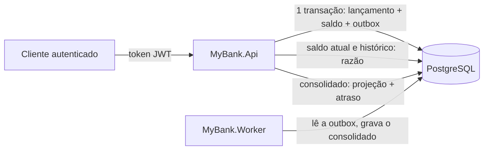

# Arquitetura — MyBank

Decisões, garantias e trade-offs (escolhas com ganhos e custos) da solução. Execução e uso estão no [README](../README.md); desempenho, em [Teste-de-Carga.md](./Teste-de-Carga.md). Termos técnicos são explicados entre parênteses no primeiro uso.

## 1. Resumo

Um **monólito modular** (um único sistema e um único banco, dividido em partes bem separadas) em .NET 10. São três peças: uma **API** (programa que recebe pedidos HTTP), um **worker** (programa separado que roda em segundo plano) e o **PostgreSQL** (banco de dados), que é a fonte de verdade. O lançamento é gravado de forma síncrona e atômica (a resposta só sai depois de tudo gravado, e grava-se tudo ou nada). A consolidação diária (resumo de cada conta por dia) é feita de forma assíncrona, depois, pelo worker, a partir de uma **Transactional Outbox** (tabela de "bilhetes pendentes" gravada na mesma transação do lançamento).

| Decisão | Escolha | Por quê |
|---|---|---|
| Estilo | Monólito modular: API + worker em processos separados, um banco | Atende à carga medida com a menor quantidade de peças. O worker separado isola a falha da consolidação |
| Consistência do saldo | Lançamento, novo saldo e evento gravados na **mesma transação** (pacote de gravações que entra inteiro ou não entra nada) | Sucesso só é respondido depois do commit (confirmação da transação). Não existe "meio lançamento" |
| Concorrência (pedidos simultâneos na mesma conta) | `SELECT ... FOR UPDATE` na linha da conta: um **lock** (trava) que reserva a linha até o fim da transação | Débitos da mesma conta entram em fila. Contas diferentes não disputam entre si |
| Idempotência (repetir o pedido não muda o resultado) | Header (cabeçalho HTTP) `Idempotency-Key` obrigatório, com valor único por conta, garantido por índice único no banco | Retry (nova tentativa) após timeout (tempo esgotado) não duplica lançamento |
| Consolidação | Outbox + worker, sem broker (programa intermediário de mensagens, como RabbitMQ ou Kafka) | Worker parado não impede lançamentos. Um broker seria mais uma peça para operar sem ganho na carga atual |
| Saldo histórico | `balance_after` (saldo depois) do último lançamento até o instante pedido | Exato, uma linha lida por índice, independente da consolidação |
| Código | 3 projetos: `Core` (regras + acesso ao banco), `Api`, `Worker` | Regras em um serviço só, sem camadas que não se pagam |

**Princípio de projeto:** colocar as garantias no banco (transação, trava de linha, índices únicos, check constraints, que são regras de verificação, e trigger, um gatilho que o banco executa sozinho), não em camadas de código. São poucas e simples, e todas são verificáveis por testes contra um PostgreSQL real.

## 2. Premissas

Premissas da demanda, adotadas como estão e cobertas por testes. Precisam de confirmação do negócio antes de ir para produção:

- Somente BRL, duas casas decimais; limite de R$ 1 trilhão por lançamento.
- A conta existe antes dos lançamentos e tem saldo inicial conhecido (abertura é uma operação administrativa).
- Saldo negativo não é permitido: débito acima do saldo dá `422 insufficient_funds` (saldo insuficiente).
- O instante do lançamento é dado pelo relógio do banco (`clock_timestamp()`, em UTC, o horário universal sem fuso), nunca pelo cliente.
- Lançamentos são imutáveis; correção é um novo lançamento compensatório.
- A consolidação diária usa a data UTC e é eventualmente consistente (pode ficar atrasada por alguns instantes, mas sempre alcança o valor certo).
- "5% de perda" foi interpretado como **taxa de respostas de erro da aplicação** sob carga. A tolerância para **perda ou duplicação de lançamento confirmado é zero** ([Teste-de-Carga.md](./Teste-de-Carga.md)).

## 3. Visão geral



```text
src/
  MyBank.Core/     Entidades, DbContext + migrations, LedgerService (regras), DailyBalanceProjector (consolidação)
  MyBank.Api/      Endpoints HTTP, JWT, conversão de erros em problem+json, health checks
  MyBank.Worker/   Laço que chama o DailyBalanceProjector
tests/
  MyBank.Tests/    API real + PostgreSQL real (Testcontainers): um teste por critério de aceite
tools/
  MyBank.LoadTests/  Gerador de carga a 50 req/s com verificação de perda e duplicação no banco
```

Glossário da árvore acima: **DbContext** (classe do EF Core, a biblioteca de acesso a banco, que representa o banco no código); **migrations** (scripts que criam e atualizam as tabelas); **endpoints** (endereços da API); **JWT** (JSON Web Token: crachá digital assinado); **problem+json** (formato padrão de resposta de erro); **health checks** (endereços que informam se o sistema está saudável); **Testcontainers** (biblioteca que sobe um banco temporário no Docker durante os testes); **req/s** (requisições por segundo).

| Tabela | Conteúdo e garantias no banco |
|---|---|
| `accounts` (contas) | Titular, saldo inicial, saldo atual, última sequência. `CHECK balance >= 0` |
| `ledger_entries` (razão: lançamentos) | Únicos `(account_id, sequence)` e `(account_id, idempotency_key)`; `CHECK amount > 0`; trigger bloqueia `UPDATE`/`DELETE` |
| `outbox_messages` (bilhetes pendentes) | Um evento por lançamento (`entry_id` único), gravado no mesmo commit. `processed_at` (processado em) vazio = pendente |
| `daily_balances` (consolidado diário) | Por conta e dia: abertura, créditos, débitos, fechamento, quantidade |

Valores em `numeric(19,2)` (número decimal exato, com 2 casas), nunca `float` (número aproximado, que gera erro de arredondamento).

## 4. Fluxos e garantias

### 4.1 Registrar lançamento

```mermaid
sequenceDiagram
    autonumber
    participant C as Cliente
    participant A as API
    participant DB as PostgreSQL
    C->>A: POST /accounts/{id}/entries (JWT, Idempotency-Key)
    A->>A: valida tipo, valor, moeda, escala e chave
    A->>DB: BEGIN; SELECT conta FOR UPDATE
    A->>A: titular = sub do token? senão 403
    A->>DB: já existe lançamento com essa chave nesta conta?
    alt chave já usada
        A-->>C: mesmo conteúdo: 201 original + Idempotent-Replayed / outro conteúdo: 409
    else chave nova
        A->>A: saldo insuficiente? 422 (rollback)
        A->>DB: clock_timestamp()
        A->>DB: INSERT lançamento e outbox; UPDATE saldo e sequência
        A->>DB: COMMIT
        A-->>C: 201 Created
    end
```

(`BEGIN` abre a transação, `COMMIT` confirma, `rollback` desfaz tudo; `sub` é o campo do token com a identidade do usuário.)

- **Atomicidade** (tudo ou nada): qualquer falha antes do commit desfaz tudo. Banco indisponível retorna `503` com o header `Retry-After` (tente de novo depois de N segundos), e o cliente repete com a mesma chave.
- **Concorrência:** a trava da linha da conta serializa (põe em fila) os lançamentos da mesma conta, **inclusive repetições simultâneas da mesma chave**. A segunda requisição só lê depois que a primeira confirmou, então encontra o lançamento e devolve a repetição. O índice único `(account_id, idempotency_key)` é a última barreira.
- **Idempotência sem tabela extra:** a chave fica no próprio lançamento. A repetição compara tipo, valor e descrição com o lançamento original. Só sucessos ficam memorizados, então uma repetição depois de um `422` é reavaliada.
- **Instante:** lido do banco depois de obter a trava, para que a ordem dos instantes acompanhe a sequência da conta.

### 4.2 Consolidação diária (worker)

```mermaid
sequenceDiagram
    autonumber
    participant W as Worker
    participant DB as PostgreSQL
    loop enquanto houver eventos (senão espera 1 s)
        W->>DB: BEGIN; até 500 eventos pendentes FOR UPDATE SKIP LOCKED
        W->>DB: lê os lançamentos desses eventos
        W->>DB: upsert em daily_balances por (conta, dia)
        W->>DB: marca os eventos como processados; COMMIT
    end
```

- **Sem perda, sem duplicidade:** somar no consolidado e marcar o evento como processado acontecem na mesma transação. Se o worker cair no meio, nada é confirmado e o lote (grupo de até 500 eventos) volta para a fila.
- **Vários workers:** `SKIP LOCKED` ("pule as linhas que outro já reservou") faz cada worker pegar eventos diferentes. Os upserts (comando "se não existe, cria; se existe, atualiza") são feitos em ordem fixa (conta, dia) para evitar deadlock (dois processos esperando um pelo outro para sempre).
- **A ordem não importa:** créditos, débitos e quantidade são somas. A abertura vem do lançamento de **menor** sequência do dia e o fechamento do de **maior** sequência. O resultado é o mesmo em qualquer ordem de chegada, então não é preciso controlar sequência nem guardar checkpoint (marcador de "até onde já processei").
- **Atraso visível:** a consulta do consolidado devolve `projection.pendingEntries` (lançamentos ainda não consolidados) e `upToDate` (em dia: sim/não), para o cliente saber se o dado está atrasado.

### 4.3 Consultas

- **Saldo atual:** `accounts.balance`, atualizado no mesmo commit do lançamento.
- **Saldo em `T`:** `balance_after` do último lançamento com `recorded_at <= T` (horário do registro até `T`), ordenado por `(recorded_at, sequence)`, via índice. Sem lançamento até `T`, vale o saldo inicial. `T` exige fuso explícito (ex.: `Z` ou `-03:00`).
- **Consolidado:** linhas de `daily_balances` no período (até 366 dias) + estado da projeção (outro nome para o consolidado: uma visão derivada do razão).

## 5. API

Prefixo `/api/v1`. Erros em `application/problem+json` com um `code` (código) estável. Contrato OpenAPI (descrição padrão dos endereços da API) em `/openapi/v1.json`, somente em Development (ambiente de desenvolvimento).

| Operação | Contrato | Respostas |
|---|---|---|
| Registrar lançamento | `POST /accounts/{id}/entries`, header `Idempotency-Key`, corpo `{type, amount, currency, description?}` (tipo, valor, moeda, descrição opcional) | `201`; repetição: `201` com o mesmo corpo + `Idempotent-Replayed: true`; `400`, `403`, `404`, `409 idempotency_key_reused`, `422 insufficient_funds`, `503` |
| Consultar lançamento | `GET /accounts/{id}/entries/{entryId}` | `200`, `403`, `404` |
| Saldo atual ou histórico | `GET /accounts/{id}/balance[?at=2026-10-09T12:00:00Z]` | `200 {balance, at}`, `400 invalid_instant` |
| Consolidado | `GET /accounts/{id}/daily-balances?from=YYYY-MM-DD&to=YYYY-MM-DD` | `200 {projection: {pendingEntries, upToDate}, days}`, `400 invalid_date_range` |
| Abrir conta | `POST /accounts {ownerId, initialBalance}` (papel `accounts-admin`) | `201`, `400`, `403` |
| Token local | `POST /dev/token {subject, roles?}` (somente Development) | `200 {accessToken}` |
| Saúde | `GET /health/live`, `/health/ready`, `/health/projection` | ver seção 7 |

Códigos HTTP usados: 200 ok; 201 criado; 400 pedido inválido; 401 sem autenticação; 403 sem permissão; 404 não encontrado; 409 conflito; 422 recusado por regra de negócio; 503 serviço indisponível.

Campos desconhecidos no corpo são rejeitados: o cliente não consegue informar `recordedAt` (horário), `balanceAfter` (saldo), sequência nem titular.

## 6. Segurança

- **Autenticação** (provar quem é): JWT Bearer (token enviado no header `Authorization`), com validação de emissor, audiência (para qual sistema o token foi feito), expiração e algoritmo de assinatura. Em produção, provedor OIDC (OpenID Connect, padrão de login como "entrar com Google/Microsoft"), configurado em `Auth:Authority`. Localmente, chave HMAC (assinatura com chave secreta compartilhada) e `POST /dev/token`, que só existe em Development.
- **Autorização** (o que pode fazer) **por conta:** o titular da conta é a claim (campo do token) `sub`. Conta de outro titular dá `403` em leitura e escrita. Abrir conta exige o papel `accounts-admin`.
- **Entrada:** tipo, valor, escala (casas decimais), moeda, chave e descrição são validados antes de abrir a transação. Corpo limitado a 16 KB. Check constraints no banco cobrem o caso de uma regra falhar no código.
- **Dados sensíveis:** respostas de erro sem stack trace (lista interna de chamadas do programa no momento do erro). Logs (registros de execução) sem corpo nem headers, então o token não é registrado. TLS (criptografia da conexão, o "https") e HSTS (instrução para o navegador sempre usar https) fora de Development.
- **Segredos:** as credenciais versionadas em `appsettings.Development.json` (arquivo de configuração local) são só do PostgreSQL local do `docker-compose`. Fora do ambiente local, use variáveis de ambiente ou um secret store (cofre de senhas, como Azure Key Vault).

## 7. Operação e falhas

| Situação | Comportamento | Como perceber |
|---|---|---|
| Worker parado | Lançamentos continuam sendo aceitos normalmente. O consolidado fica atrasado e informa isso (`upToDate: false`) | `/health/projection`: `Degraded` (degradado) com o evento mais antigo acima de 30 s, `Unhealthy` (não saudável, código 503) acima de 5 min |
| Worker volta | Processa o backlog (fila acumulada) sem duplicar | `pendingEvents` volta a 0 |
| Banco indisponível | API responde `503` + `Retry-After`; nada é confirmado. O worker registra o erro e tenta de novo a cada 5 s | `/health/ready` falha; logs de erro |
| Lote que sempre falha (bug de dados) | O worker tenta de novo indefinidamente, sem pular evento | `/health/projection` fica `Unhealthy`. Ação manual: corrigir e reiniciar |
| Consolidado suspeito | Reconstrução completa a partir da outbox, sem tocar no razão: `BEGIN; TRUNCATE mybank.daily_balances; UPDATE mybank.outbox_messages SET processed_at = NULL; COMMIT;` (`TRUNCATE` esvazia a tabela) | Coberto pelo teste `Consolidacao_pode_ser_reconstruida_do_zero_a_partir_da_outbox` |

- `/health/live` (vivo) só indica que o processo responde. `/health/ready` (pronto) depende só do banco. O atraso do worker **não** derruba a prontidão da API, porque a API continua funcionando sem ele.
- Logs estruturados em JSON (cada linha é um objeto com campos, fácil de pesquisar) fora de Development. Métricas HTTP nativas do ASP.NET Core (contadores de requisições e tempos) disponíveis via `dotnet-counters` (ferramenta de linha de comando do .NET).
- Para escalar horizontalmente (rodar mais cópias do programa), rode mais instâncias da API, porque o estado fica todo no banco, ou do worker, porque o `SKIP LOCKED` divide a fila.

## 8. Alternativas consideradas

| Alternativa | Por que não agora | Quando reavaliar |
|---|---|---|
| Consolidar na mesma requisição do lançamento | Falha da consolidação derrubaria o lançamento, o que contraria o requisito principal | — |
| Microsserviços (vários sistemas pequenos, cada um com seu banco, conversando pela rede) | Consistência distribuída, deploy (implantação) e observabilidade (capacidade de enxergar o que acontece em produção) mais caros, sem necessidade medida. 50 req/s cabem com folga em um processo ([Teste-de-Carga.md](./Teste-de-Carga.md)) | Equipes ou requisitos de escala realmente independentes. A primeira fronteira natural é o worker, que já roda separado |
| Broker | A outbox no próprio banco já entrega o evento com garantia. Um broker exigiria publicar a partir da outbox de qualquer forma | Vários consumidores, fan-out (o mesmo evento indo para vários destinos) ou consolidação em outro banco |
| Event Sourcing (guardar só os eventos e recalcular todo o estado a partir deles) | Razão imutável + saldo transacional + outbox já cobrem auditoria e reprocessamento com menos conceitos (snapshots, que são fotos periódicas do estado, versionamento de eventos, projeções obrigatórias) | Replay (reprocessar todos os eventos) de várias projeções ou auditoria por eventos como requisito central |
| Controle otimista (cada linha tem uma versão; quem gravar com versão velha falha e tenta de novo) em vez de trava | Sob disputa na mesma conta, exigiria retry no cliente ou no servidor. A trava de linha é mais simples, e o cenário `hot-account` (todos os lançamentos na mesma conta) mostra p95 de 17 ms | Contenção (disputa pela mesma linha) medida que justifique |
| Cache (cópia rápida em memória) de saldo | O saldo que autoriza débito não pode estar desatualizado. As consultas ficam abaixo de 15 ms no p95 (95% das respostas até esse tempo) sem cache | Leituras muito acima da carga atual, e só para consultas |

### Simplificações deliberadas

Uma primeira versão deste projeto tinha camadas Domain/Application/Infrastructure (domínio, aplicação, infraestrutura), `Result<T>` (objeto que carrega sucesso ou erro), interfaces de repositório e unit of work (abstrações sobre o acesso ao banco), um processador da outbox com advisory lock (trava lógica do PostgreSQL) por conta, controle de sequência e tabela de deduplicação, um comando de reconciliação e métricas customizadas. Ela funcionava e passava nos mesmos critérios, mas com cerca de 80 arquivos para cinco endpoints. Foi reescrita porque:

- As garantias reais vêm do banco: trava, transação, índices únicos. As camadas só repassavam chamadas.
- Um consolidado calculado só por somas e por abertura e fechamento pela sequência não depende de ordem. Isso eliminou checkpoint, ordenação e deduplicação no worker.
- Reconciliação e métricas customizadas foram substituídas por um procedimento SQL testado e pelo `/health/projection`. Voltam como evoluções se a operação pedir.

## 9. Critérios de aceite e evidências

Cada critério de aceite (condição que a demanda exige) tem um teste com o mesmo número em [`AcceptanceCriteriaTests`](../tests/MyBank.Tests/AcceptanceCriteriaTests.cs), executado contra PostgreSQL real.

| # | Critério | Evidência |
|---|---|---|
| 1, 2 | Crédito e débito alteram o saldo exatamente pelo valor | `C01`, `C02` |
| 3 | Valor zero, negativo, escala > 2, moeda não suportada, tipo inválido, conta inexistente e chave ausente são rejeitados sem gravar | `C03` (7 casos) |
| 4 | Débito acima do saldo é rejeitado sem efeito | `C04` |
| 5 | Débitos concorrentes não negativam o saldo | `C05`: 50 débitos simultâneos sobre saldo para 20, exatamente 20 aceitos. Sem o `FOR UPDATE`, o teste falha |
| 6 | Mesma chave e mesmo conteúdo: um lançamento | `C06`, inclusive 10 repetições simultâneas |
| 7 | Mesma chave com outro conteúdo: conflito sem efeito | `C07` |
| 8 | Worker parado não impede lançamentos; ao voltar, alcança o razão sem duplicar | `C08`, `ProjectionTests` (4 workers simultâneos) e carga com worker parado |
| 9 | Saldo histórico antes, no instante e depois de cada lançamento | `C09` |
| 10 | 50 req/s, p50/p95/p99 (tempos em que 50%, 95% e 99% das respostas ficaram), erros e zero perda | [Teste-de-Carga.md](./Teste-de-Carga.md) |
| 11 | Build sem warnings (avisos do compilador) e testes em CI (integração contínua: o GitHub compila e testa a cada envio) | `TreatWarningsAsErrors` (avisos viram erros) + analisadores de código `latest-recommended`; [ci.yml](../.github/workflows/ci.yml) |

Segurança (`401`, `403`, papel admin, campos proibidos, instante sem fuso, imutabilidade no banco) está em [`SecurityTests`](../tests/MyBank.Tests/SecurityTests.cs).

## 10. Evoluções futuras

Em ordem de prioridade, com o gatilho de cada uma:

1. **OpenTelemetry** (padrão aberto para enviar rastros e métricas a ferramentas de monitoramento, como Prometheus), com alerta sobre `/health/projection`: primeiro passo para produção.
2. **Rate limiting** (limite de pedidos por cliente em um intervalo), contra abuso e vizinhos ruidosos.
3. **Expurgo** (apagar dados antigos) da outbox processada após o período de retry acordado. Antes disso, criar um snapshot do consolidado, porque a reconstrução hoje usa a outbox completa.
4. **Extrato paginado** (devolvido em partes, ex.: `GET /entries?afterSequence=`), aproveitando o índice por sequência.
5. **Fuso contábil configurável** para o fechamento diário, quando confirmado pelo negócio.
6. **Dead letter** (fila separada para eventos com falha) se surgirem eventos que precisem ser isolados sem parar a consolidação.
7. **Particionamento** de `ledger_entries` (dividir a tabela por período) e **réplica de leitura** (cópia do banco só para consultas), quando o volume justificar.
8. **Broker / Event Sourcing / microsserviços** somente nas condições da seção 8.
