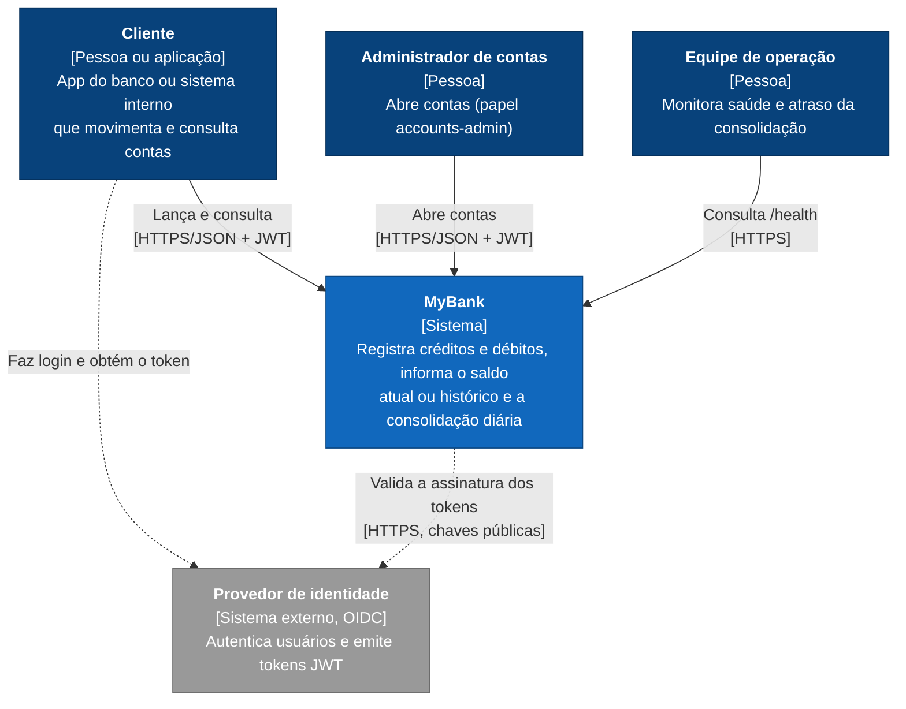
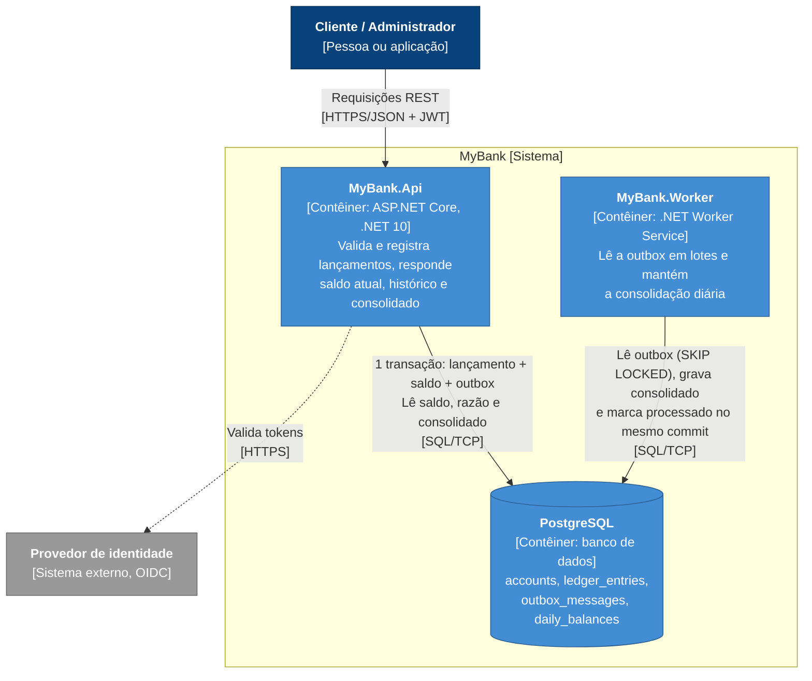
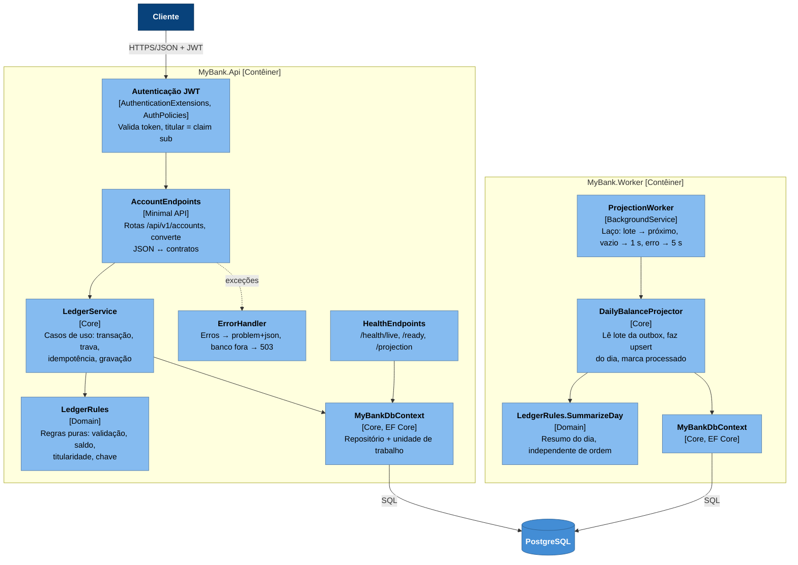

# Modelo C4 — MyBank

Diagramas da arquitetura no **modelo C4**, do zoom mais aberto ao mais fechado. As decisões por trás de cada parte estão nos [ADRs](./ADR.md); fluxos, garantias e operação, em [Architecture.md](./Architecture.md).

O modelo C4 tem quatro níveis de zoom: contexto, contêineres, componentes e código. Os três primeiros estão abaixo; o quarto nível (classes) não foi desenhado, porque o próprio código, com um tipo por arquivo, já mostra isso. No C4, **contêiner** é qualquer coisa que roda ou guarda dados separadamente (uma aplicação, um banco), não necessariamente um contêiner Docker.

Legenda: azul-escuro = pessoa; azul = parte do MyBank; cinza = sistema externo.

## 1. Nível 1: Contexto

Quem usa o sistema e com quem ele se relaciona.

*Diagrama de Contexto (C4, nível 1)*

## 2. Nível 2: Contêineres

As partes que rodam separadamente e como conversam. API e worker **não se comunicam diretamente**: o único ponto de contato é o banco, pela outbox ([ADR-0003](./adr/0003-outbox-transacional-sem-broker.md)).

*Diagrama de Contêineres (C4, nível 2)*

| Contêiner | Escala | Se parar |
|---|---|---|
| `MyBank.Api` | Várias instâncias (sem estado; trava na linha da conta) | Nada é registrado |
| `MyBank.Worker` | Várias instâncias (`SKIP LOCKED` divide a fila) | Lançamentos continuam; o consolidado atrasa e informa o atraso |
| PostgreSQL | Vertical; réplica de leitura e particionamento como evolução | Nada é confirmado; a API responde `503` e o cliente repete com a mesma chave |

## 3. Nível 3: Componentes

As principais partes dentro de cada contêiner. `LedgerService`, `DailyBalanceProjector` e `MyBankDbContext` estão no projeto `MyBank.Core`; `LedgerRules` está no `MyBank.Domain`. API e worker usam os mesmos componentes do `Core`, cada um no seu processo.

*Diagrama de Componentes (C4, nível 3)*
